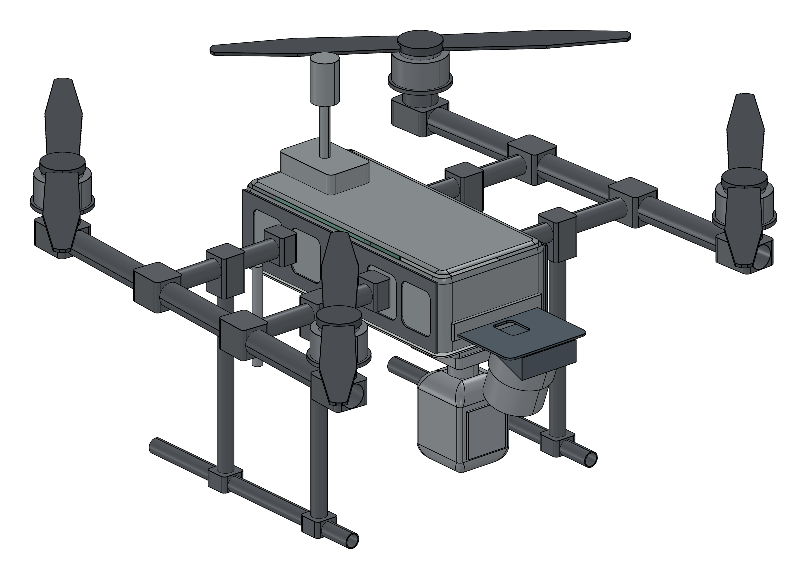

# Assas (عساس)

**A Cooperative Drone Workflow: GPS-Independent Visual Positioning and Terrain Change Detection**

SAIF 2026 · Khaled Naif Alharbi · Malk Muqbil Albishri

Hills, valleys and dunes can block a border tower's view of the ground beyond it. Assas is a proposed drone swarm that launches from existing towers, shares the survey area among its drones, compares new 3D LiDAR scans with an earlier scan to locate changes, and uses onboard AI on daylight or thermal images to help explain what changed.

## Repository contents

| Folder | Contents |
|---|---|
| [`website/`](website/) | Operator website: dashboard, setup and storage, running on simulated data |
| [`cad/`](cad/) | Assas R1 drone CAD: STEP assembly, bill of materials, renders and poster figure |

## Hardware: Assas R1

Assas R1 is the patrol quadcopter that makes up the swarm: a 70-part, **4.26 kg** design on a carbon-fiber H-frame with a 658 mm wheelbase and 16 in propellers on 6S motors. Its sensor nose carries an inverted, 20°-pitched Livox Mid-360 LiDAR and a SIYI ZT6 EO/IR thermal gimbal. A Jetson Orin NX with an ARKV6X flight controller sits on a vibration-isolated carrier, power comes from a 6S3P battery, and an aluminum belly plate doubles as the heat sink.

- [CAD overview, specifications and gallery](cad/)
- [Download the STEP assembly](cad/models/Assas_R1_assembly.step)

## References

### Swarm coverage
1. J. Muñoz, B. López, F. Quevedo, C. A. Monje, S. Garrido, and L. E. Moreno, "Multi UAV Coverage Path Planning in Urban Environments," *Sensors*, vol. 21, no. 21, Art. no. 7365, 2021. [doi:10.3390/s21217365](https://doi.org/10.3390/s21217365)

### Aerial positioning
2. R. G. Thalagala, O. De Silva, A. Jayasiri, A. Gubbels, G. K. I. Mann, and R. G. Gosine, "MUN-FRL: A Visual-Inertial-LiDAR Dataset for Aerial Autonomous Navigation and Mapping," *The International Journal of Robotics Research*, vol. 43, no. 12, pp. 1853–1866, 2024. [doi:10.1177/02783649241238358](https://doi.org/10.1177/02783649241238358)

### Multiple viewpoints
3. D. C. Schedl, I. Kurmi, and O. Bimber, "An Autonomous Drone for Search and Rescue in Forests Using Airborne Optical Sectioning," *Science Robotics*, vol. 6, no. 55, Art. no. eabg1188, 2021. [doi:10.1126/scirobotics.abg1188](https://doi.org/10.1126/scirobotics.abg1188)

### AI assessment
4. I. Kurmi, D. C. Schedl, and O. Bimber, "Combined Person Classification with Airborne Optical Sectioning," *Scientific Reports*, vol. 12, Art. no. 3804, 2022. [doi:10.1038/s41598-022-07733-z](https://doi.org/10.1038/s41598-022-07733-z)

### Landmine detection

5. . "Detection of 'Legbreaker' Antipersonnel Landmines by Analysis of Aerial Thermographic Images of the Soil," *Infrared Physics & Technology*, Elsevier, 2022. [doi:10.1016/j.infrared.2022.104307](https://doi.org/10.1016/j.infrared.2022.104307)

### Border security context

6. . Saudi Press Agency (SPA), Official Report. [https://www.spa.gov.sa/en/N2191636](https://www.spa.gov.sa/en/N2191636)

### Terrain & hazard mapping

7. . *Natural Hazards and Earth System Sciences*, vol. 19, pp. 1235–1251, 2019. [doi:10.5194/nhess-19-1235-2019](https://doi.org/10.5194/nhess-19-1235-2019)

### Counter-UAS & jamming

8. A. H. Michel, "Counter-Drone Systems," 2nd ed., Center for the Study of the Drone at Bard College, Dec. 2019. [PDF](https://dronecenter.bard.edu/files/2019/12/CSD-CUAS-2nd-Edition-Web.pdf)
