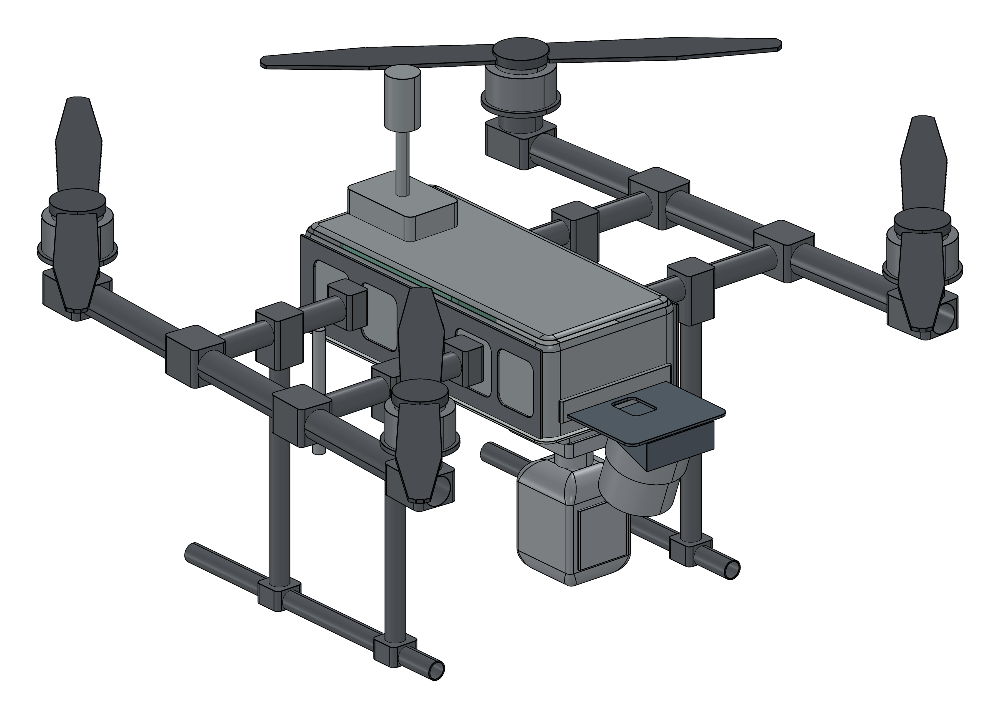
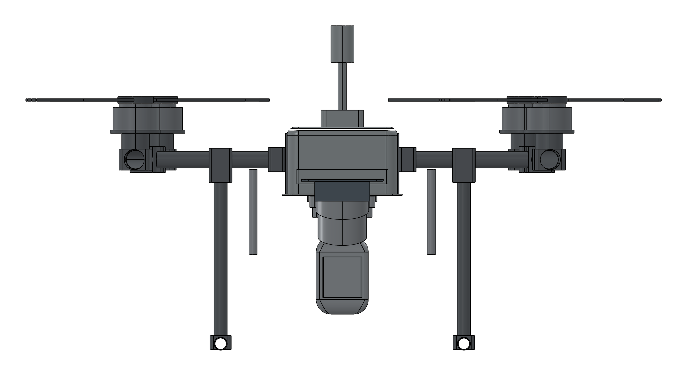
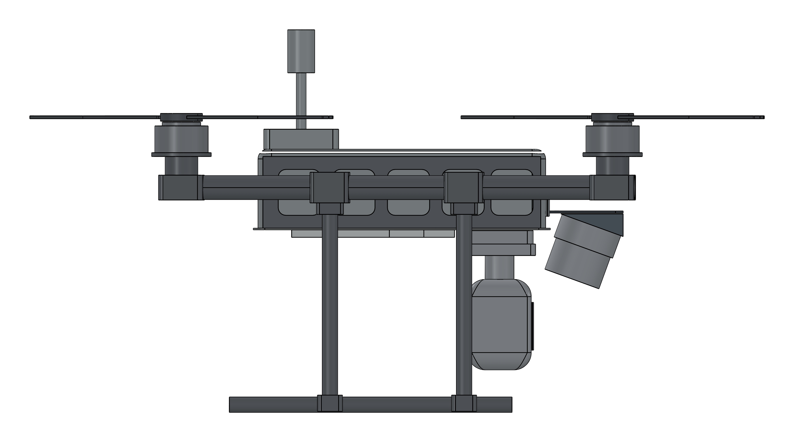
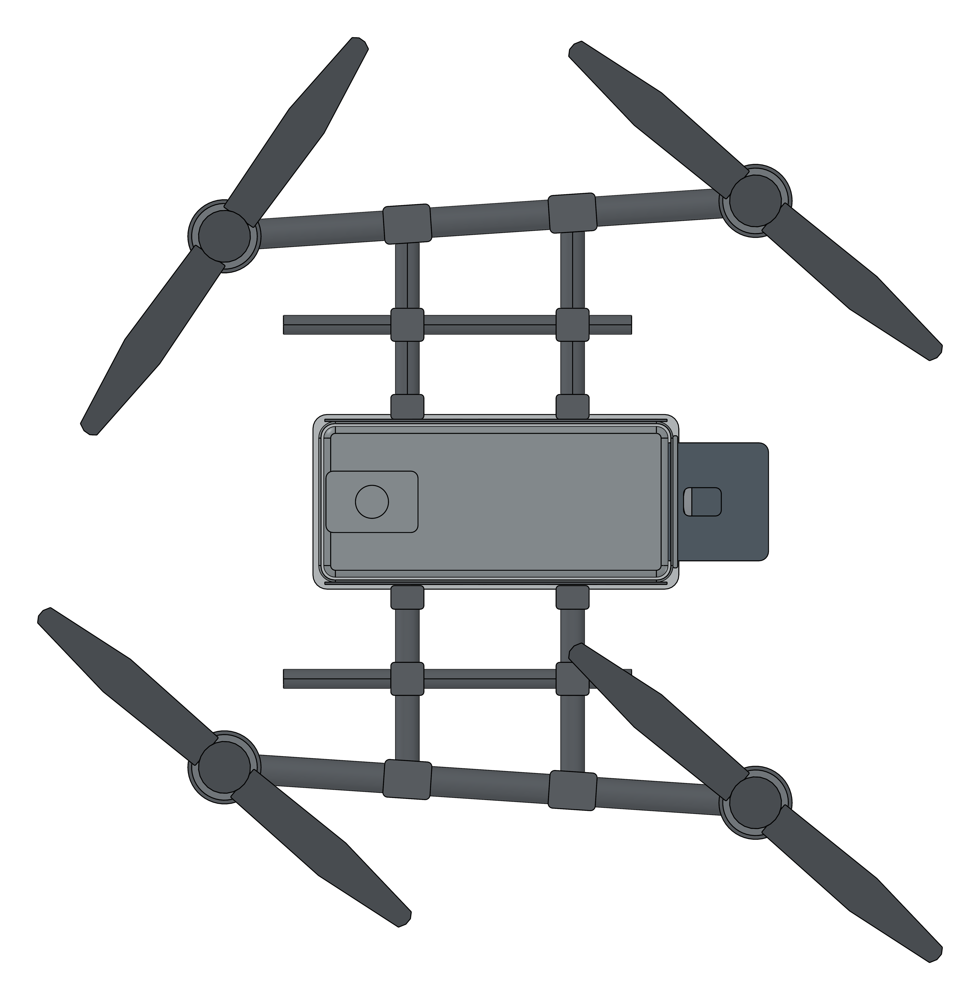
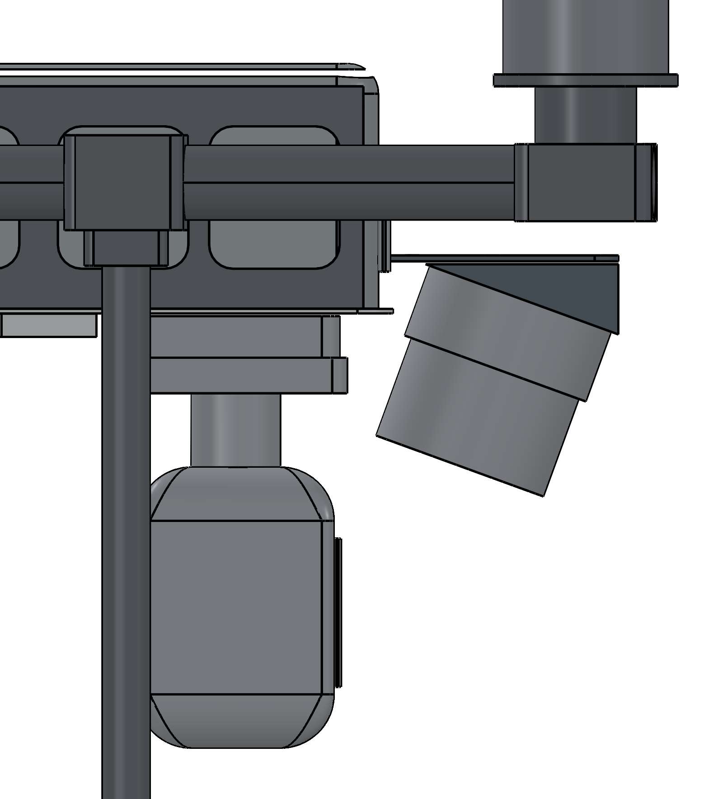
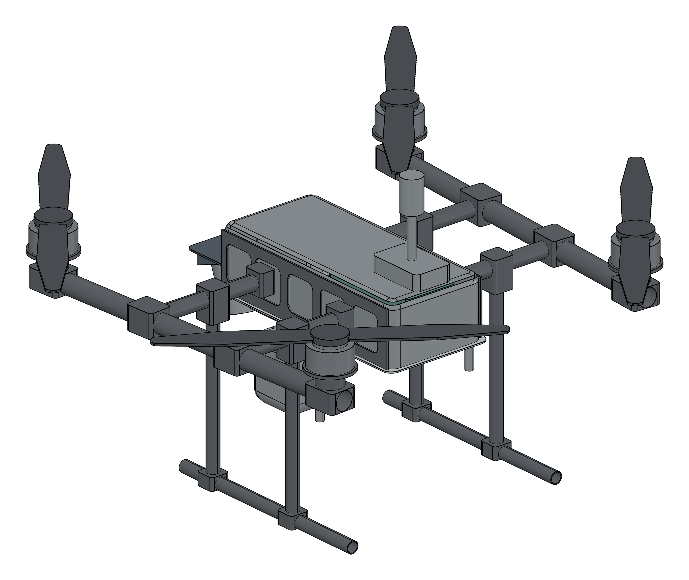

# Assas R1 (عساس): drone CAD



**Assas R1** is the full-size CAD model of the patrol quadcopter used by the عساس drone swarm. It is a complete 70-part assembly with an all-up mass of **4.26 kg**, built around a carbon-fiber H-frame, a forward-facing LiDAR and EO/IR sensor nose, and an onboard edge-AI computer.

## System architecture


*From top to bottom: upper enclosure and GNSS mast, 6S3P battery, onboard computer and flight controller, isolated sensor carrier with the inverted 20° LiDAR, carbon-fiber H-frame with motors and landing gear, and the aluminum heat-sink plate carrying the ESCs and the SIYI ZT6 gimbal. A print-ready vector PDF is in [`figures/Assas_R1_figure_poster.pdf`](figures/Assas_R1_figure_poster.pdf).*

## Technical specifications

| Item | Assas R1 |
|---|---|
| Airframe | Asymmetric carbon-fiber H-frame: 25/23 mm side rails, 2 mm carbon side plates, 658 mm diagonal wheelbase |
| Assembly | 70 named parts in a single STEP file (mm) |
| All-up mass | **4.26 kg** |
| Propulsion | 4 × T-Motor MN5008 KV400 motors (6S) with 16 × 5.4 in carbon propellers |
| LiDAR | Livox Mid-360, mounted upside down on a 20° wedge at the nose (coverage +27° to −71°) |
| EO/IR camera | SIYI ZT6 daylight/thermal gimbal, full −90° to +25° pitch range unobstructed |
| Onboard compute | NVIDIA Jetson Orin NX on an ARK PAB carrier with an ARKV6X flight controller, on a vibration-isolated sensor carrier |
| Navigation and comms | ARK MOSAIC-X5 GNSS on a carbon mast, LightWare LW20/C downward rangefinder, Doodle Labs Mesh Rider radio |
| Battery | 6S3P semi-solid-state pack, 1450 g |
| Thermal | 1.6 mm Al 6061 belly plate that doubles as the heat sink, with fins cooled by rotor downwash |
| Enclosure | Printed ASA upper shell gasketed to the belly plate, TPU boot around the sensor carrier |

### Mass breakdown

| Group | Mass (g) |
|---|---|
| Battery 6S3P | 1450 |
| Avionics, sensors, mounts, wiring | 1040 |
| Frame, enclosure, landing gear | 809 |
| Propulsion (motors, propellers, ESCs) | 728 |
| Belly heat-sink plate and fins | 233 |
| **Total** | **4260** |

## Gallery

| Front | Side |
|---|---|
|  |  |
| Left-right symmetric layout, with the EO/IR gimbal on the centreline under the body. | The 20° LiDAR wedge and gimbal hang forward of the body, clear of the front rotors. |
| **Top** | **Underside** |
|  |  |
| Front motors are set wider (±255 mm) than the rear (±225 mm) to keep the rotors clear of the nose sensors. | The finned aluminum belly plate is the structural floor and the main heat sink. |
| **Nose sensor close-up** | **Rear isometric** |
|  |  |
| Inverted Livox Mid-360 on its 20° wedge above the SIYI ZT6 EO/IR gimbal. | GNSS mast, enclosure and landing gear from behind. |

## Design checks on R1

- No interference between any pair of parts.
- Centre of gravity within 1 mm of the rotor centre (X +0.6 mm, Y +0.3 mm).
- The airframe blocks 0 % of the LiDAR's forward ±60° sector (23 % of its full field of view).
- Camera sits 44.5 mm above the ground when landed.

R1 is a design layout: some part envelopes are estimated, and wiring, fasteners and structural or thermal analysis are not yet modelled.

## Directory

```
cad/
├── README.md
├── models/
│   ├── Assas_R1_assembly.step     Complete 70-part assembly (mm)
│   └── Assas_R1_bom.csv           Bill of materials: type, material/source, mass, centre position
├── renders/
│   ├── iso_front.png              Front isometric
│   ├── iso_rear.png               Rear isometric
│   ├── exploded.png               Exploded stack-up
│   ├── front.png                  Front orthographic
│   ├── side.png                   Side orthographic
│   ├── top.png                    Top orthographic
│   ├── underside.png              Underside orthographic
│   └── nose_sensor_detail.png     Nose sensor close-up
└── figures/
    ├── Assas_R1_figure_poster.pdf Labelled poster figure (vector)
    └── Assas_R1_figure_poster.png Labelled poster figure (raster)
```

## Opening the STEP assembly

[`models/Assas_R1_assembly.step`](models/Assas_R1_assembly.step) is one self-contained file with no external part links. Coordinates: X forward, Y left, Z up; the X/Y origin is the centre of the four rotors and Z = 0 is the underside of the belly plate.

1. Download the file: open it on GitHub and click **Download raw file**. GitHub does not preview STEP files in the browser.
2. Open it in any of these:
   - **SOLIDWORKS**: File → Open, set the file type to STEP, and select the file. It imports as an assembly.
   - **FreeCAD** (free): File → Open.
   - **Fusion**: upload it to a project, or drag it into the window.
   - **No install**: drag the file into [3dviewer.net](https://3dviewer.net).
