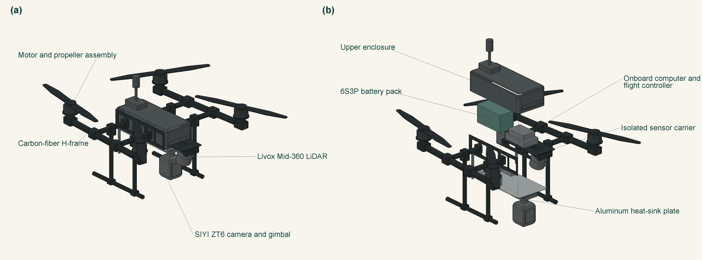
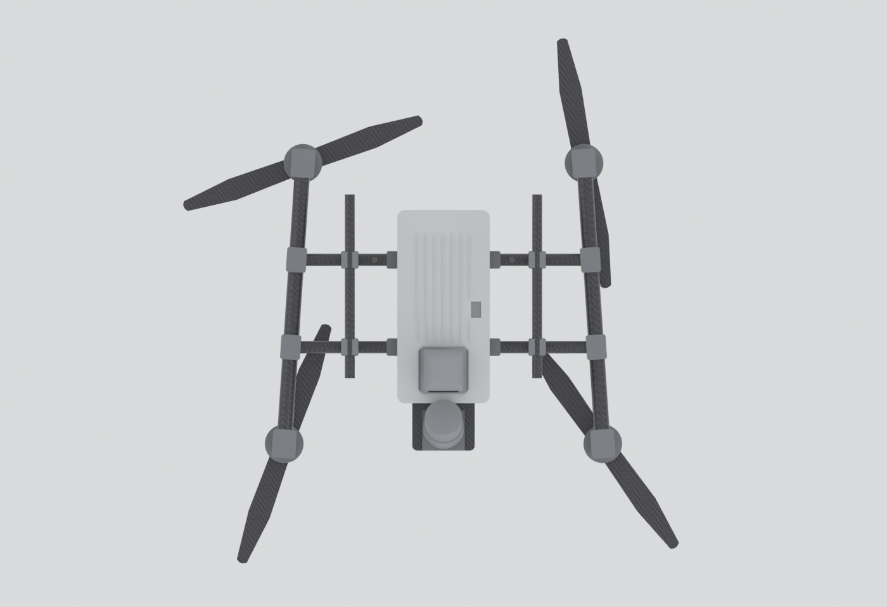
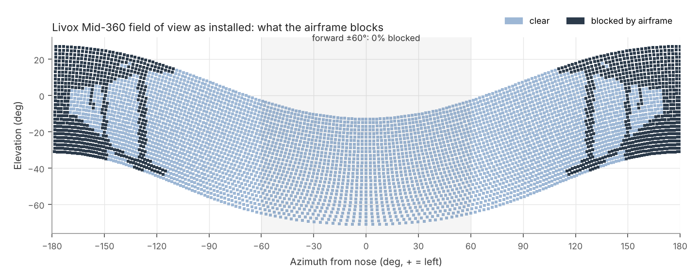

# Desert Hawk DH-01: CAD assets (revision R1)

Full-size layout of the Desert Hawk patrol quadcopter. The model shows the airframe architecture and how the payload is packaged. It is a design layout: no structural, thermal or aerodynamic analysis has been done, and it has not been flight-tested.

## Files

| File | What it is |
|---|---|
| [`Desert_Hawk_DH-01_R1_assembly.step`](Desert_Hawk_DH-01_R1_assembly.step) | Complete assembly, a single STEP file with 70 named, coloured parts, in mm. Opens in any CAD tool or STEP viewer with no missing part links. |
| [`bom_mass_parts_list.csv`](bom_mass_parts_list.csv) | Bill of materials: every part with its type (make, print or buy), material or source, tube cut length, mass and centre position. |
| [`renders/`](renders/) | Isometric, front, side, top, underside and nose-detail renders of the R1 geometry. |
| [`figures/`](figures/) | Two-panel assembled/exploded figure and the LiDAR field-of-view blockage map. |

Coordinates: X forward, Y left, Z up. The X/Y origin is the centre of the four rotors, and Z = 0 is the underside of the belly plate.

## Airframe architecture

- **Asymmetric carbon-fiber H-frame.**
  - Structure: two 25/23 mm carbon side rails run motor to motor, joined to 2 mm carbon side plates by four 20/18 mm stubs.
  - Rotor spacing: the front motors are set wider (±255 mm) than the rear (±225 mm), so the front rotors stay clear of the nose sensors.
  - Diagonal wheelbase: 658 mm.
- **Propulsion.** 16 × 5.4 in carbon propellers (406.4 mm) on 6S MN5008-class motors. The tip-to-tip gap between neighbouring rotors is 44–104 mm.
- **Inverted, 20°-pitched Livox Mid-360 LiDAR.** Mounted upside down on a printed 20° wedge at the nose. In world terms its coverage runs from +27° to −71°.
- **SIYI ZT6 EO/IR gimbal.** Hangs under the front of the belly on a printed bracket. Its full pitch range (−90° to +25°) is unobstructed.
- **Isolated sensor carrier.** A 2 mm carbon plate on four wire-rope isolators. It carries the LiDAR and the Jetson Orin NX / ARK PAB / ARKV6X stack together, so the IMU and the LiDAR stay rigidly coupled.
- **Al 6061 heat-sink plate.** The 1.6 mm belly plate is both the structural floor and the heat sink, with longitudinal fins cooled by rotor downwash.
- **Enclosure.** A printed upper shell gasketed to the belly (IP65 target, not tested), with a TPU boot where the sensor carrier passes out.
- **Battery.** A 6S3P semi-solid-state pack (1450 g) positioned to put the centre of gravity on the rotor centre.

| Front | Side |
|---|---|
|  |  |
| **Top** | **Underside** |
|  |  |

## Mass breakdown (R1 model)

| Group | Mass (g) |
|---|---|
| Avionics, sensors, mounts, wiring | 1040 |
| Battery 6S3P | 1450 |
| Frame, enclosure, landing gear | 809 |
| Propulsion (motors, props, ESCs) | 728 |
| Belly heat-sink plate and fins | 233 |
| **Total** | **4260** |

Bought-in parts use datasheet masses; made parts are calculated from volume × density. Average avionics power is 37.3 W (48.8 W peak), from the system baseline.

## Checks run on the R1 geometry

- No interference between any pair of parts.
- Centre of gravity within 1 mm of the rotor centre (X +0.6, Y +0.3 mm).
- Camera 44.5 mm above the ground when landed.
- The airframe blocks 23 % of the LiDAR's full field of view and 0 % of the forward ±60° sector.

## Known limitations

- The motor bolt pattern and some part envelopes (ESCs, isolators, antennas, battery shape) are estimates.
- No wiring, seals, fasteners, dock contacts or structural/thermal analysis.
- The Livox manual asks for at least 0.5 m between an inverted sensor's mounting surface and the ground; R1 has 196 mm when landed.
- The Jetson sits on the isolated carrier, so it needs a flexible thermal strap to the belly plate; this is not modelled.
